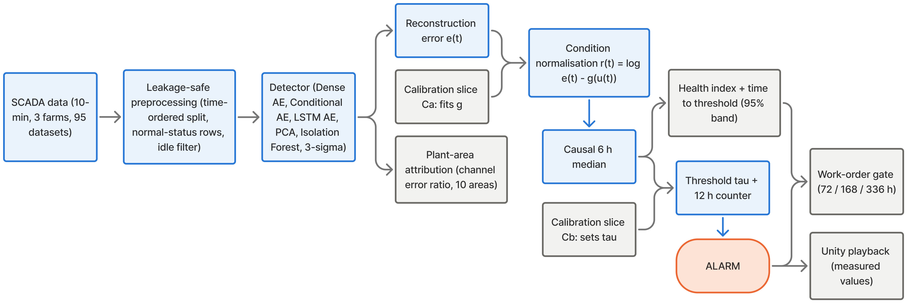
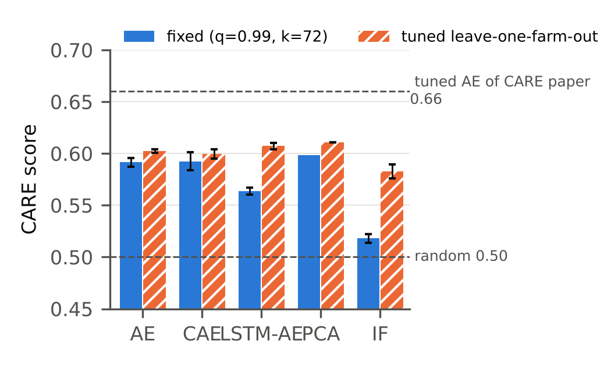
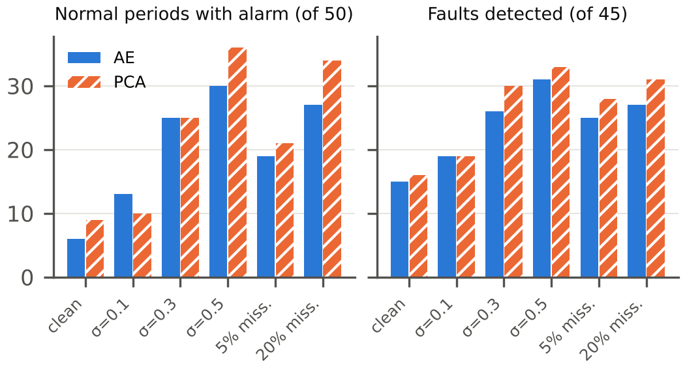

# Predictive maintenance of wind turbines from SCADA data

Early fault detection, fault attribution and maintenance timing for wind turbines, built on
the public **[CARE-to-Compare](https://zenodo.org/records/15846963)** benchmark
(3 wind farms, 36 turbines, 95 datasets, 45 labelled faults, 50 normal periods),
with a Unity scene that replays the turbine's measured state and the model's warnings.



## What the project does

1. **Learns normal behaviour.** Detectors are trained only on healthy rows from each
   turbine's training year: a dense autoencoder (AE), a conditional AE that sees the
   operating conditions, an LSTM AE over 1-hour windows, PCA, Isolation Forest and a
   3σ rule.
2. **Removes what the weather explains.** Reconstruction error grows with wind and load even
   on a healthy turbine. A gradient-boosting model, fitted on a held-out slice, predicts the
   expected error from wind speed, power, rotor speed and ambient temperature, and only the
   excess is scored (*condition normalisation*). A causal 6-hour median then removes spikes.
3. **Raises alarms the way operators would.** A row is flagged above the 99th percentile of
   held-out healthy scores; an alarm needs 12 hours of net flagged behaviour (the benchmark's
   criticality counter).
4. **Says where to look.** Every sensor is mapped to one of ten plant areas (pitch/hub, yaw,
   hydraulics, cooling, gearbox, generator, drive train, nacelle/tower, electrical,
   environment), and areas are ranked by how much worse the AE reconstructs them during the
   fault than when healthy.
5. **Suggests when to act.** A causal health index (1 = healthy, 0.5 = alarm threshold) and
   its recent slope give a time to a failure floor, with an uncertainty band; if an alarm is
   active and that time drops under 72, 168 or 336 hours, a work order is proposed.
6. **Shows it.** Measured wind speed, rotor speed, power and temperatures, with the score,
   alarm, health index and time-to-threshold, are exported per time step for a Unity
   playback of the turbine.

Everything is **leakage-safe**: data are split by time, scalers, imputers, models and
thresholds only ever see the training year, the test window stays untouched until it is
scored, and no setting was changed after looking at test results.

## Results on all 95 datasets

| Detector | Post-processing | CARE (fixed settings) | CARE (tuned on other farms) | Faults detected / 45 | Normal periods with alarm / 50 |
|---|---|---|---|---|---|
| AE | none | 0.584 ± 0.002 | 0.607 | 11.3 | 5.0 |
| AE | normalisation + smoothing | 0.592 ± 0.004 | 0.602 | 15.3 | 7.0 |
| Conditional AE | none | 0.590 ± 0.007 | 0.603 | 11.7 | 3.7 |
| LSTM AE | none | 0.531 ± <0.001 | 0.601 | 5.0 | 3.0 |
| AE, sigmoid output | none | 0.498 | – | 6 | 10 |
| PCA | normalisation + smoothing | 0.598 | 0.611 | 16 | 9 |
| Isolation Forest | none → normalisation + smoothing | 0.471 → 0.518 | 0.527 → 0.582 | 2.3 → 9.3 | 4.3 → 8.3 |

CARE is the benchmark's score (coverage, earliness, event reliability and accuracy on normal
periods; 0.5 = random predictions; the benchmark's per-farm tuned AE reports 0.66).
± is the s.d. over three seeds.

- **Post-processing:** a paired bootstrap over datasets finds no significant difference
  between the AE variants, or between the AE, the conditional AE and PCA. Condition
  normalisation cuts false alarms but also hides load-dependent fault signal; it helps the
  weaker Isolation Forest significantly (+0.047, 95 % CI 0.003 to 0.091).
- **Architecture:** the LSTM AE is lower (−0.054, CI −0.092 to −0.019), and a sigmoid output
  layer costs 0.086 (CI 0.025 to 0.146) because it cannot reproduce negative standardised values.
- **Tuning:** choosing threshold and alarm counter on two farms and testing on the third adds
  up to 0.07; even tuning on the test data reaches only 0.619, so most of the gap to 0.66 is
  not threshold choice.
- **Attribution:** the right plant area is ranked first for 37 % of 40 labelled faults
  (random 12 %, raw z-scores 22 %, always naming the commonest area 30 %).
- **Case studies:** for a generator-bearing failure (dataset 40) the alarm came roughly a
  month before the fault window closed, and the generator was the top-ranked area; a
  cooling-water valve fault (dataset 44) went undetected, yet cooling was still the top area.
- **Cost:** every detector trains in under 25 s per turbine-year on a T4 GPU and scores
  1000 rows in at most 10 ms.

Full tables: [`results/`](results). Figures: [`figures/`](figures).

<p>
 
</p>

## Repository layout

```
pipeline/          the validated pipeline
  wtpm_lib.py        data access, leakage-safe preprocessing, detectors, condition
                     normalisation, CARE score, attribution, tuning helpers
  run_benchmark.py   all 95 datasets -> stored row-level scores (resumable, time-budgeted)
  analyze_case.py    one dataset: health index, time to threshold, gate study, attribution,
                     temperature model and Unity export (farm C)
  merge_results.py   stored scores -> result tables (merges run A and run B)
  make_figures.py    summary figures from the result tables
  run_all.py         everything in one go, ends with a zip
tests/             unit tests (39) for the library and the merge step
results/           tables and case studies of the final run
figures/           framework diagram, summary and case-study figures
docs/kaggle.md     how to reproduce the full run on Kaggle
prototype/         first semester prototype (kept for history; not used for results)
```

## Reproduce

On Kaggle (GPU, about 5 hours): follow [`docs/kaggle.md`](docs/kaggle.md).

Locally (downloads only the needed files from Zenodo with HTTP range requests):

```bash
pip install -r requirements.txt
python -m pytest -q tests
# quick check on three datasets, 2 epochs
python pipeline/run_all.py --data-dir data --out out --zip out/results.zip --events 7 21 40 --epochs 2
# full run A and run B, then merge and draw figures
python pipeline/run_all.py --data-dir data --out out --zip out/results_v3.zip
python pipeline/run_all.py --detectors lstm --data-dir data --out out_b --zip out/results_v3_lstm.zip
python pipeline/merge_results.py --inputs out/benchmark out_b/benchmark --out results/tables
python pipeline/make_figures.py --tables results/tables --out figures
```

## Data

CARE-to-Compare by Gück, Roelofs and Faulstich (Fraunhofer IEE), *Data* 9(12):138, 2024,
distributed via [Zenodo](https://zenodo.org/records/15846963) under its own licence.
The data are not copied into this repository. The CARE score follows the dataset paper
and, where it leaves a choice open, the authors' reference implementation
[EnergyFaultDetector](https://aefdi.github.io/EnergyFaultDetector).

## Authors

N Ananth, Roshan Kalirajan, Samarth B N and Veena Gadad, RV College of Engineering,
Bengaluru. See [`CITATION.cff`](CITATION.cff) to cite this work.
